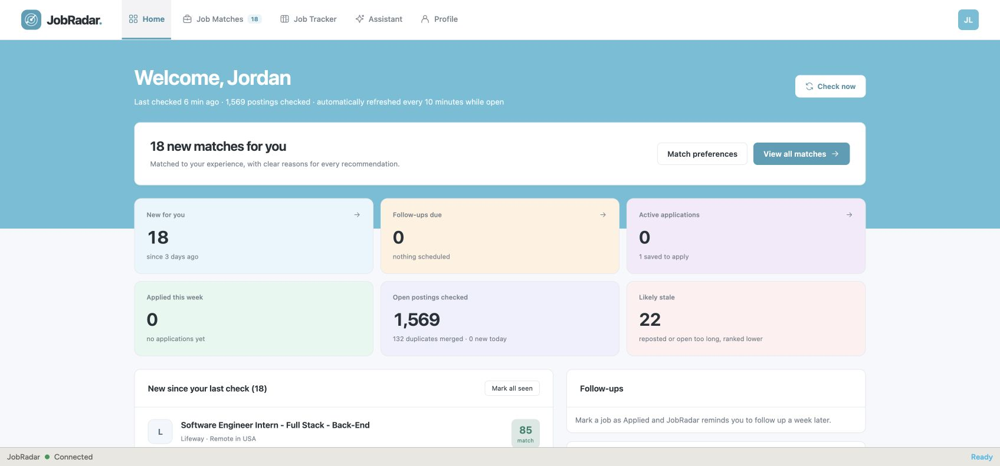

# JobRadar

A job-search dashboard for internships and new-grad roles that shows you what
is **new** and worth your time, and keeps everything else out of the way.

- **Only what is new.** New postings that match you pop up as notifications and land in **New**. Opening, saving or hiding a job takes it out of New. Older matches wait under **All matches**.
- **Duplicates merged.** The same role from several sources becomes one card, linked to the company's own application page when there is one.
- **Ghost and stale checks.** Each card shows when the role was first posted, how many times it was reposted, and whether it closed. Likely stale roles rank lower and can be hidden.
- **Transparent scores.** Every point comes with a reason you can read. **Explain fit** pairs each requirement with your own resume evidence and lists honest gaps. It never invents experience.
- **Tracker with follow-ups.** Saved, Applied, Online assessment, Interview, Offer, Closed. Marking a job Applied schedules a follow-up reminder; the AI drafts the email, and you send it.
- **Assistant.** Chat with a Gemini agent that knows your matches and applications, saves reminders and notes, and reads any job link you paste.
- **Free and local.** No subscription and no auto-apply. Your resume lives in your own Redis.

## Screens

| Screen | What it is for |
|---|---|
| Dashboard | New since your last check, follow-ups due, pipeline, today's best picks, closed-posting alerts |
| Jobs | New / All matches / Hidden, with search, freshness, remote and stale filters |
| Job details | Why it matches, freshness, the full posting, Explain fit, cover note and follow-up drafts, tracker status and notes |
| Tracker | Board of applications, reminders (automatic and from the assistant), assistant notes |
| Assistant | Chat with suggested questions |
| Profile and sources | Resume import, target roles, locations, sponsorship, score threshold, watched companies, demo tools |

## Where jobs come from

- The SimplifyJobs internship and new-grad lists on GitHub (about 8,000 open roles, updated several times a day). Their history of closed postings powers repost detection.
- Any company's own Greenhouse, Lever or Ashby board that you add under **Watch company**. These give full descriptions, and a closed posting is detected when it disappears.

Sources are re-checked every 10 minutes while the app is open, and whenever you press **Check now**.

## Interface

The interface follows Simplify's product layout: white top navigation, a cyan
dashboard welcome area, pastel summary cards, and a job list beside its selected
role. The reference screens are published in Simplify's
[dashboard guide](https://help.simplify.jobs/en/help/articles/6390631-navigate-your-dashboard)
and [job board guide](https://help.simplify.jobs/en/articles/2830264-view-jobs-on-simplifys-job-board).

- `src/design.css` owns the app-scoped palette, spacing, cards, and responsive
  layouts. It does not change the shell's global theme.
- `src/ui.tsx` provides the shared page header, panels, metric tiles, and job
  cards. `src/icons.tsx` holds the JobRadar mark and interface icons.
- `App.tsx` renders top navigation through a single `AppLayout`, with the shell's
  connection status bar. The profile avatar opens Profile and sources.
- `JobPanel` reuses the same actions and content in an embedded job-board view
  and the existing drawer on other screens. At narrow widths, selecting a job
  replaces the result list; closing the detail restores the list. Detail tabs
  support arrow keys, Home, and End.
- The sample resume is fictional. Importing it creates a local demo profile
  and checks live job sources. Demo replay and reset actions are under the
  collapsed **Demo and data controls** section on Profile and sources.

## RocketRide pipelines (`src/pipelines/`)

| File | Nodes | Used for |
|---|---|---|
| `jobradar-tools.pipe` | `tools` + 3 x `tool_redis` + `tool_firecrawl` | Every read and write the app makes (`client.tool`). Each Redis node is locked to its own namespace: job index (`jobradar:jobs:`), your data (`jobradar:u:alex:`), seen and hidden marks (`jobradar:seen:alex:`). |
| `profile.pipe` | `webhook` → `parse` → `response_text`, and `question` → `prompt` → `llm_gemini` → `response_answers` | Resume to profile JSON plus the plain resume text |
| `writer.pipe` | `chat` → `prompt` → `llm_gemini` → `response_answers` | Explain fit, cover note, follow-up email |
| `assistant.pipe` | `chat` → `agent_rocketride` (+ `llm_gemini`, `memory_internal`, read-only `tool_redis`, notes-only `tool_redis`, `tool_firecrawl`) → `response_answers` | The assistant. It reads everything and can write only under `jobradar:u:alex:notes:`. |

All LLM nodes use Gemini 3.5 Flash Lite with `${ROCKETRIDE_GEMINI_KEY}`; Firecrawl uses `${ROCKETRIDE_FIRECRAWL_KEY}`. Both are resolved on the engine.

## How Redis is used

| Key | What it does | Tools |
|---|---|---|
| `jobs:idx:{0..31}` | Sharded first-seen index, which powers "new" and pruning | GET, SET |
| `jobs:lock:refresh` | Lock so two tabs never write the index at once (120 s) | SET NX, DELETE |
| `jobs:desc:{fp}` | Job description cache in front of Firecrawl (7 days) | SET with expiry, GET |
| `jobs:stat:{date}:{metric}` | Daily counters (35 days) | INCR, EXPIRE |
| `u:alex:profile`, `resume`, `prefs`, `state` | Your profile, resume text, preferences, last visit | GET, SET |
| `u:alex:app:{fp}` | Tracker record | SET, SET XX, DELETE |
| `u:alex:remind:{fp}` | Follow-up reminder; expires 14 days after it is due | SET with expiry |
| `u:alex:fit:{fp}` | Cached Explain fit (7 days) | SET with expiry, GET |
| `u:alex:stat:applied:{week}` | Applications per week | INCR, EXPIRE |
| `u:alex:digest` | Snapshot the assistant reads (1 day) | SET with expiry |
| `u:alex:notes:*` | Reminders and notes the assistant saved | SET (by the agent), SCAN |
| `seen:alex:s:{fp}` / `h:{fp}` | Seen (45 days) and hidden (90 days) marks | SET NX with expiry, SCAN |

## Running it

Setup, checks and run steps are in `../../README.md` (the
`demos/jobradar/README.md` file at the top of this demo).

## Demo script (about 4 minutes)

1. **Profile and sources:** drop your resume, or press **Try it with a sample resume**. The profile appears in a few seconds and the first check runs.
2. **Watch company:** add `ramp` or `scaleai`. Their postings pop up as new matches.
3. **Dashboard:** show New since your last check, today's picks, and the stale count.
4. Open a job, then **Explain fit**: requirement-to-evidence pairs and honest gaps.
5. **Save to tracker**, then **Mark applied**. The Tracker shows the follow-up reminder; **Drafts** gives a follow-up email.
6. **Assistant:** "Which applications should I follow up on?", then "Remind me to prep for Ramp on Friday". The reminder appears in Tracker. Paste any job link and ask "is this a fit?".
7. To show the live "new posting" moment again: **Profile and sources > Replay the last 24 hours as new**.

## Limits

- No background scan while the app is closed: app pipelines cannot be scheduled.
- No Gmail sync yet (no Gmail token configured).
- Single user (`alex`, set in the pipelines and `src/lib/redis.ts`).
- `tool_redis` is not yet in a released engine, so this runs only on an engine with that node loaded.
- The local Redis has no persistence: removing the container loses your tracker.
